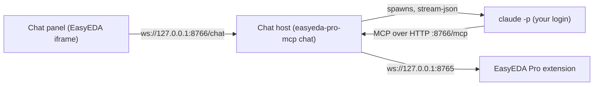

# Chat Inside EasyEDA Pro

The **MCP Bridge → Claude Chat** menu opens a chat panel inside EasyEDA Pro. The panel does not call any AI service itself. It sends your messages to the [Claude Code](https://code.claude.com) CLI installed on your computer, which answers with **your own Claude login** (for example a Claude Pro or Max subscription) and uses this project's EasyEDA tools on the open schematic or PCB.



## Requirements

- Claude Code CLI installed. You can sign in from the panel with **Sign in with Claude**: it runs Claude Code's own `claude auth login --claudeai`, which opens a browser to log in to your Claude account. Signing in from a terminal (`claude`, then `/login`) works too. **Sign out** in the status bar runs `claude auth logout`, which signs Claude Code out on the whole computer.
- Node.js 20+.
- The EasyEDA MCP Bridge extension, version with the **Claude Chat** menu item.

## Start

1. In a terminal, run:

   ```bash
   npx -y @vlabsoftware/easyeda-pro-mcp chat
   ```

   Keep the terminal open. The chat host holds the bridge port `8765`, so close AI clients that start `easyeda-pro-mcp` themselves (Claude Desktop, Cursor and so on) first. Otherwise the host reports that the port is in use.

2. In EasyEDA Pro, open a schematic or PCB, then choose **MCP Bridge → Connect**.
3. Choose **MCP Bridge → Claude Chat**.

The panel opens as a floating, non-modal window along the right edge, so the editor stays usable. Minimize or move it like any EasyEDA window, and drag its left edge to change the width. The width is remembered for the next time it opens. EasyEDA's extension API has no way to dock extension content into the built-in right panel where Copilot lives. The status bar shows your Claude plan, the connected EasyEDA document, and your current usage windows (5-hour and 7-day). The panel also works in a normal browser at `http://127.0.0.1:8766/`.

## History

Conversations are saved in `~/.easyeda-pro-mcp/chat/history/`, one file per conversation. After the chat host restarts, the latest conversation opens again. **History** lists saved conversations. Opening one shows its messages and resumes the same Claude Code session, so Claude keeps that conversation's context. **New** starts a fresh conversation without deleting the old one. If Claude Code no longer has an old session, the messages stay visible and your next message continues in a new session.

Options:

| Option | Default | Purpose |
| --- | --- | --- |
| `--port <port>` | `8766` (`EASYEDA_CHAT_PORT`) | Port for the panel and the local MCP endpoint |
| `--model <model>` | your Claude Code default | Model alias or name, for example `sonnet` or `opus`; it can also be changed in the panel |
| `EASYEDA_CHAT_ALLOWED_ORIGINS` | EasyEDA web origins | Extra origins allowed to open the panel, comma-separated |
| `EASYEDA_CHAT_CLAUDE_BIN` | `claude` on `PATH` | Path to the Claude Code executable |

## What Claude can do

The panel offers this project's tools plus any other EasyEDA MCP servers you already use with Claude Code. At startup the chat host reads `~/.easyeda-pro-mcp/chat/mcp-servers.json` (same `{"mcpServers": {...}}` format as Claude Code). If that file is missing, it picks EasyEDA-related servers from `~/.claude.json`, for example [`easyeda-copilot-mcp`](https://github.com/biosshot/easyeda-copilot), which edits schematics, places components and routes PCBs. The EasyEDA MCP Bridge extension bundles Copilot's EasyEDA-side client (MIT), so the separate EasyEDA Copilot extension is **not** needed. Disable it if it is installed, otherwise two EasyEDA instances answer the Copilot server. **MCP Bridge → Copilot Tools: Pause/Resume** turns the bundled client off and on. The chat host pins an unversioned `easyeda-copilot-mcp` to the bundled client's version (1.3.2). This project's own stdio entry is skipped because the chat host already provides it. Start with `--no-extra-mcp` to offer only this project's tools.

Tools that a server marks read-only (`readOnlyHint`) run without asking. Every other tool shows an approval card. **Allow for this chat** approves that tool for the rest of the conversation, which helps during long placement and routing work.

- **Read-only tools** (context, nets, components, DRC run, exports and so on) run without asking.
- **Project-changing tools** (`easyeda_confirmed_action`) show an approval card in the panel with the exact parameters. Nothing runs until you press **Allow**. Unanswered requests are denied after 5 minutes.
- Claude Code's own shell, file and web tools are disabled for these sessions, and your personal Claude Code settings are not loaded, so a personal "bypass permissions" default cannot skip the approval card.

## Security

- The host listens on `127.0.0.1` only and rejects requests whose `Host` header is not loopback.
- Browsers can reach localhost from any site, so the panel endpoint accepts only the EasyEDA Pro origins and its own page. If your EasyEDA client uses another origin, the host prints `Rejected Origin "<origin>"`. Add that exact value to `EASYEDA_CHAT_ALLOWED_ORIGINS` only if you recognize it.
- The local MCP endpoint requires a random token that changes on every start and is passed only to the Claude Code process the host starts.

## Account and billing

- The chat uses whatever Claude Code is signed in with. Usage counts toward that plan's limits and is shared with your other Claude Code sessions.
- The host removes `ANTHROPIC_API_KEY` from the Claude Code environment so an inherited key does not silently switch billing to the API.
- This project never reads, stores or forwards your Claude credentials. Sign-in, tokens and model access stay inside Claude Code.
- Anthropic does not allow third-party products to offer claude.ai login or subscription limits without approval. This panel is a local front end for the Claude Code you installed and signed in to yourself, intended for your own use. Follow Anthropic's terms for your plan.

## Troubleshooting

| Symptom | Fix |
| --- | --- |
| Panel: "Cannot reach the chat host" | Start `npx -y @vlabsoftware/easyeda-pro-mcp chat`. If it is running, look for `Rejected Origin` in its terminal. |
| Status: "Claude Code not installed" | Install Claude Code, or set `EASYEDA_CHAT_CLAUDE_BIN` to its path. |
| Status: "Claude: not signed in" | Press **Sign in with Claude** in the panel. If no browser opens, use the sign-in link the panel shows, or run `claude auth login` in a terminal. |
| Status: "EasyEDA: not connected" | Choose **MCP Bridge → Connect** in EasyEDA Pro. |
| Host exits with "port is already in use" | Close other AI clients running `easyeda-pro-mcp`, or set `EASYEDA_MCP_WS_PORT`/`--port` for both sides. |
| "MCP server not connected" in the chat | Restart the chat host; the local MCP token changes on every start. |
